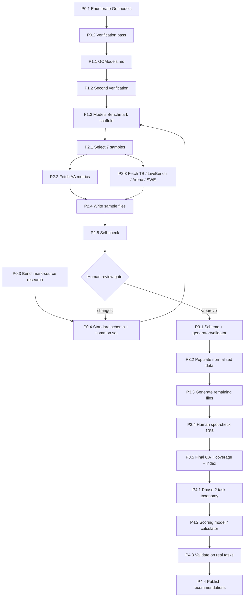

# Models Benchmark — Plan, DAG, and Status

**Project:** Standardized benchmark library for every AI model available on the **Command Code Go plan**
**Snapshot:** 2026-11-24
**Inventory:** [`../GOModels.md`](../GOModels.md) — 62 verified Go models
**Purpose:** Make task-based model selection calculable: *which Go model should I use for which job, at what quality, speed, and credit cost?*

---

## 1. What we are building

A folder of **one Markdown file per Go model**, all using the same schema, plus:

- a **model-status checklist** (this file),
- a **source registry** with credibility tiers (`sources.md`),
- a **standard template** (`_TEMPLATE.md`),
- machine-readable snapshots (`data/`),
- and a **coverage matrix** showing which benchmarks actually connect which models.

The output is deliberately not a single leaderboard. It is a **decision dataset**: raw scores, configuration, cost, speed, provenance, and gaps.

### Non-goals

- Re-running benchmarks ourselves.
- Ranking models on benchmarks that do not cover them.
- Treating vendor-reported numbers as independent evidence.
- Building the Phase 2 recommendation engine before the data is approved.

---

## 2. Research finding: there is no universal benchmark

The central constraint is real and must drive the template:

> **No single public benchmark covers all 62 Go models.** Coverage is especially thin for models released after mid-2026, which is most of the Go catalog.

Evidence from the first seven samples (all data retrieved 2026-11-24):

| Model | AA Intelligence Index | Terminal-Bench 4.1 | LiveBench 2026-06-25 | LMArena Text Elo | SWE-bench Verified |
|---|---:|---:|---:|---:|---:|
| Kimi K3.1 Pro | 46 | 59.7% | N/A (not in snapshot) | N/A (not in top/Pareto) | N/A |
| Qwen 4 Max | 43 | N/A (not on board) | N/A (released after snapshot) | N/A (not in top/Pareto) | N/A |
| Muse Ember | 36 | 30.6% | N/A (not in snapshot) | N/A (not in top/Pareto) | N/A |
| Tencent Hy4 | 35 | 37.9% | N/A (not in snapshot) | N/A (not in top/Pareto) | N/A |
| GLM-5.3 | 32 | 41.2% | 76.1% reported / category data | N/A (not in top/Pareto) | N/A |
| GPT-6 Luna | 28 | 15.2% | 72.0% reported / category data | N/A (not in top/Pareto) | N/A |
| DeepSeek V4 Pro | 23 | 6.7% | 71.6% reported / category data | 1,458 | N/A |
| **Coverage of 7** | **7/7** | **6/7** | **3/7** | **1/7** | **0/7** |

**Consequences for the design:**

1. **AA Intelligence Index is the anchor.** It is the only benchmark in the set that covers all seven samples and reports model-level cost/speed in the same harness. It becomes the required field.
2. **Terminal-Bench 4.1 is the agentic/coding anchor** for models that publish it, but it is harness-dependent and missing for Qwen 4 Max.
3. **LiveBench is a capability breakdown, not a universal score.** Its snapshot is 2026-06-25, so models released later are structurally absent. Never impute a score for a missing model.
4. **LMArena and SWE-bench are optional external checks.** They are useful when present, but their coverage of the newest Go models is currently near zero.
5. **Vendor-reported numbers fill gaps only as clearly labeled `VENDOR` data.** They never enter a cross-model ranking.

---

## 3. Goal DAG

### 3.1 Text DAG

```
P0 — Research & setup
  P0.1 Enumerate Go models (Go page + full catalog + live catalog)
  P0.2 Verification pass (count, plan gates, near-duplicates, live additions)
  P0.3 Benchmark-source research (AA, Terminal-Bench, LiveBench, Arena, SWE-bench, vendor)
  P0.4 Define standard schema, common benchmark set, missing-data rules
  P0.5 Produce model-routing recommendation for this goal

P1 — Inventory & scaffold
  P1.1 Write GOModels.md
  P1.2 Second verification of GOModels.md
  P1.3 Create Models Benchmark folder, plan.md, template, sources.md, data snapshots

P2 — Sample benchmarks (human gate)
  P2.1 Select 5+ archetype samples
  P2.2 Fetch AA metrics for samples
  P2.3 Fetch TB / LiveBench / Arena / SWE-bench for samples
  P2.4 Write one .md per sample
  P2.5 Self-check numbers, dates, configs, sources
  P2.6 HUMAN REVIEW + APPROVAL  ← stop here
  P2.7 Revise template / data based on review

P3 — Batch benchmarks
  P3.1 Build normalized schema + TypeScript generator/validator (golden test)
  P3.2 Populate normalized data for the remaining models
  P3.3 Generate remaining model files with --write; review the generation report
  P3.4 Human spot-check (10% + all conflicting rows)
  P3.5 Final QA, coverage audit, index, and dataset lock

P4 — Phase 2 (not started)
  P4.1 Task taxonomy and decision weights
  P4.2 Scoring model / calculator
  P4.3 Validate on real tasks
  P4.4 Publish model-routing recommendations
```

### 3.2 Mermaid DAG



### 3.3 Dependency rules

- **P0.2 must pass before any inventory file is written.** A wrong model list poisons every downstream file.
- **P0.4 must be approved before batch writing.** Changing the schema after 20 files creates rework.
- **P2.6 is the sample gate.** P-0001/P-0002 are approved; the seven sample files remain protected while their data is spot-checked.
- **P3.1 must pass its golden test before P3.3 writes.** The generator refuses to write until the seven samples render consistently.
- **P3.2 must complete before P3.3.** A normalized row without source dates or status codes is not ready to render.
- **P3.3 never overwrites `sample`, `approved`, or `done` files.** Only `queued`/`draft` rows are generated.
- **P4 starts only after P3.5.** Phase 2 needs a locked dataset, not a moving one.

---

## 4. Standard benchmark set

The template uses tiers so missing data never becomes a fake zero.

### Tier A — Cross-model anchor (required)

| Field | Source | Why it is the anchor |
|---|---|---|
| `aa_intelligence_index` | Artificial Analysis Intelligence Index v5.0.1 | Only benchmark covering all seven samples; independent, same harness |
| `aa_intelligence_rank` | AA model page (rank within class) | Context for the raw score |
| `aa_cost_per_task` | AA | Comparable economic efficiency |
| `aa_time_per_task` | AA | End-to-end latency |
| `aa_ttft` | AA | Time to first answer token |
| `aa_output_speed` | AA | Tokens/second |
| `context_window` | Command Code + AA | Task-fit constraint |
| `reasoning_effort_evaluated` | AA model page | Quality is effort-dependent |
| `default_effort` | AA model page | What you get without tuning |

AA Intelligence Index v5.0.1 is a weighted composite of **nine** evaluations: AA-Briefcase v1.1, AutomationBench-AA, Terminal-Bench 4.0, FrontierCode-AA 2.0, AA-Omniscience v1.1, GDP.pdf, HLE-Diamond, CritPt v2 (Hard Subset), and Terminal-Bench-Science 0.1. Four categories contribute 25% each: Knowledge Work, Coding, Science, General.

### Tier B — Capability modules (required when published)

| Benchmark | Version | What it measures | Configuration to record |
|---|---|---|---|
| Terminal-Bench | 4.1 official board | Agentic terminal/coding, 89 tasks | Agent harness (Claude Code, Codex, mini-swe-agent, etc.), effort, date, ±CI |
| LiveBench | 2026-06-25 CSV | Objective reasoning, coding, math, data analysis, language, instruction following | Release date, task-level or category-level, effort variant |
| LMArena Text | Official Arena leaderboard | Human preference Elo | Snapshot date, model configuration, rank/score |
| SWE-bench Verified | Official `swebench.com` JSON | Real GitHub issue resolution | Agent harness, date, `checked` flag |

### Tier C — Supplementary (optional, labeled)

- AA evaluations not exposed as machine-readable tables: AA-Omniscience accuracy/hallucination, HLE-Diamond, GPQA Diamond, MMLU-Pro, IFBench, AA-LCR, MMMU-Pro, τ²-Bench, SciCode, LiveCodeBench, AIME, MATH-500.
- Vendor-reported rows from model launch posts/model cards: DeepSWE, ProgramBench, HLE, GPQA, AIME, HealthBench, Chartography, etc. Marked `VENDOR`.
- Third-party evaluators (e.g., PostTrainBench, OpenHarmony Bench, Gert Labs) only when the benchmark itself published the run; marked with the runner.

### Not used for ranking

- BenchLM’s composite “Capability” score. Its own AA table mixes index versions (e.g., DeepSeek V4 Pro shows 53.2% there vs 23 on AA’s current index). It is a discovery aid only.
- LLM-Stats, LLM Benchmark, The Model Gap, Village Atlas, and similar aggregators. Use them to find primary sources, not as citations.
- Social-media screenshots, unsourced “best model” posts, and undated charts.

---

## 5. Missing-data rules

Every benchmark cell must resolve to one of these states:

| Code | Meaning | Enters ranking? |
|---|---|---|
| `value` | Numeric score with source, date, config | Yes, within that benchmark |
| `NP` | Model exists but benchmark has not published a result | No |
| `NE` | Benchmark has not evaluated this model | No |
| `NM` | Result exists but is not machine-readable/accessible | No |
| `STALE` | Benchmark snapshot predates the model release | No |
| `PROXY` | Score belongs to a different variant/sibling | **No** |
| `VENDOR` | Vendor-reported, not independently run | **No** |

Rules:

1. **Never write `0` for missing data.** A zero is a score; a gap is not.
2. **Never aggregate across benchmark versions.** AA v5.0.1 ≠ AA v4; LiveBench 2026-06-25 ≠ 2026-11.
3. **Never compare different effort settings as if they were the same model.** Record `max`, `high`, `default`, etc.
4. **Never compare different agent harnesses on Terminal-Bench/SWE-bench as if they were model-only.** Record the harness.
5. **A proxy is allowed in prose with a warning, never in a ranking table.** Example: Kimi K3’s LiveBench score is not Kimi K3.1 Pro’s score.
6. **Conflicts are preserved, not averaged.** If two credible sources disagree, record both and flag the row.

---

## 6. Per-model file contract

Each model gets:

```
Models Benchmark/models/<slug>.md
```

Required front matter:

```yaml
---
cc_id: "exact/command-code-id"
display_name: "Model Name"
provider: "Provider"
snapshot_date: "2026-11-24"
status: "sample | approved | done | blocked"
aa_slug: "artificial-analysis-slug-or-null"
weights: "open | open-restricted | closed | stealth | unknown"
context: "1M"
reasoning: true
efforts: ["low", "medium", "high"]
evaluated_effort: "max"
---
```

Required sections: identity, Go economics, AA headline, common benchmark table, capability profile, verdict/routing, provenance, changelog. The exact structure is in [`_TEMPLATE.md`](./_TEMPLATE.md).

Every numeric row must carry:

- benchmark + version,
- score + unit,
- configuration (effort/harness),
- source URL,
- retrieval date,
- provenance label (`AA`, `TB`, `LB`, `Arena`, `SWE`, `VENDOR`, etc.).

---

## 7. Human-in-the-loop protocol

### Gate 1 — Sample review (current)

1. Seven samples are written: Qwen 4 Max, Kimi K3.1 Pro, Tencent Hy4, GLM-5.3, Muse Ember, GPT-6 Luna, DeepSeek V4 Pro.
2. The user reviews at least five, ideally all seven.
3. The user checks:
   - Is the schema sufficient for task-based decisions?
   - Are the numbers plausible and correctly sourced?
   - Is the missing-data treatment acceptable?
   - Is the model-to-task routing recommendation sensible?
4. **Only after explicit approval** does batch processing start.

### Gate 2 — Batch spot-check

1. Process the remaining 55 models in small batches.
2. Self-check every file against its source.
3. Present a 10% random sample plus every row with conflicting sources.
4. Lock the dataset after sign-off.

### Change control

- If the schema changes after approval, update `_TEMPLATE.md` and re-run the affected sample files before resuming the batch.
- If a model is added/removed from the Go plan, update `GOModels.md` and the checklist here first.

---

## 8. Model-routing recommendation for this goal

This is the “quick sweep” result: which Go models to use for each task type inside this project, based on the sample data and published benchmarks. It is a working recommendation, not the final Phase 2 engine.

### 8.1 Task routing table

| Task type in this goal | Primary | Secondary / budget | Evidence and reason |
|---|---|---|---|
| **Planning, DAG design, architecture** | `moonshotai/Kimi-K3.1-Pro` | `Qwen/Qwen4-Max` | Kimi has the highest AA index on Go (46) and the best published Terminal-Bench 4.1 score among the samples (59.7%). Qwen is close (43) with 1M multimodal context. |
| **Enumerating models / reading docs** | `Qwen/Qwen4-Max` | `deepseek/deepseek-v4-pro` | Qwen handles text+image+video and 1M context; DeepSeek is cheaper for text-only long docs but weaker overall (AA 23). |
| **Bulk extraction and normalization** | `meta/muse-ember` | `gpt-6-luna` | Muse Ember is the efficiency outlier: AA 36 at **$0.14/task**, 420 tok/s, 5.1s TTFT, ~15,800 req/mo. GPT-6 Luna is cheaper per token with ~9,090 req/mo but AA 28 at max and 18 at default. |
| **Long-context research synthesis** | `Qwen/Qwen4-Max` | `deepseek/deepseek-v4-pro` | Both have 1M context. Qwen has higher AA (43 vs 23); DeepSeek is much cheaper per token and has strong LiveBench reasoning (88.6) but weak agentic coding (TB 6.7%). |
| **Coding / parsing scripts** | `zai-org/GLM-5.3` | `moonshotai/Kimi-K3.1-Pro` | GLM-5.3 has TB 41.2% and the highest LiveBench instruction-following among samples (88.5); Kimi has TB 59.7% but costs far more per task. |
| **Verification / QA of numbers** | `moonshotai/Kimi-K3.1-Pro` + `Qwen/Qwen4-Max` | `tencent/hy4` | Two-model cross-check. Kimi is the strongest reasoner; Qwen is a strong independent second read. Hy4 is a cheaper third opinion (AA 35, TB 37.9%). |
| **Writing the 55 remaining model files** | `meta/muse-ember` | `gpt-6-luna` | Speed and credit efficiency matter more than top-end reasoning for template-filled files. Escalate hard cases to Kimi/Qwen. |
| **Final human-facing summary** | `Qwen/Qwen4-Max` or `meta/muse-ember` | `zai-org/GLM-5.3` | Qwen for depth; Muse Ember for speed. GLM for structured instruction following. |
| **Free / zero-credit experimentation** | `recursive/flint-v1.0:free` | `stealth/glyph-cluster:free` | Both are free but capped at 1,000 req/day, may train on data, and have no published benchmark coverage. Never use for sensitive work. |

### 8.2 Budget guardrails

| Model | Go credits/mo | Req/mo (est.) | Cost/task (AA) | Use it for |
|---|---:|---:|---:|---|
| Kimi K3.1 Pro | $6 | 441 | $3.68 | High-stakes reasoning, planning, final QA only |
| Qwen 4 Max | $6 | 1,030 | $3.27 | Long-context synthesis and multimodal review |
| GLM-5.3 | $10 | 677 | $5.01 | Coding/agentic tasks where TB score matters |
| Tencent Hy4 | $6 | 1,840 | $1.03 | Mid-cost reasoning and second opinions |
| Muse Ember | $6 | 15,800 | $0.14 | Bulk extraction, drafting, summarization |
| GPT-6 Luna | $6 | 9,090 | $0.15 | High-volume cheap tasks |
| DeepSeek V4 Pro | $6 | 2,960 | $1.77 | Cheap 1M-context text reasoning, not coding agents |

**Practical rule for this project:** use **Muse Ember** for volume, **Qwen 4 Max** for long-context synthesis, **Kimi K3.1 Pro** for planning and final verification, and **GLM-5.3** only when a coding/instruction-following step justifies its cost.

### 8.3 What not to do

- Do **not** use Kimi K3.1 Pro for bulk file generation: 441 requests/month and 35.7 minutes/task.
- Do **not** use GLM-5.3 for bulk extraction: $5.01/task and 27.8 minutes/task.
- Do **not** use DeepSeek V4 Pro for agentic coding: Terminal-Bench 4.1 is 6.7%.
- Do **not** treat GPT-6 Luna’s default (medium) as its max score: AA 18 at default vs 28 at max.
- Do **not** use free/stealth models for repository data: no ZDR, and their benchmark coverage is effectively zero.

---

## 9. Current status

### 9.1 Phase status

| Phase | Status | Evidence |
|---|---|---|
| P0.1 Enumerate Go models | **Done** | 62 models from the Go page |
| P0.2 Verification pass | **Done** | 62/62 reconciled; live additions resolved |
| P0.3 Benchmark-source research | **Done** | AA, Terminal-Bench, LiveBench, Arena, SWE-bench, vendor registry in `sources.md` |
| P0.4 Standard schema + common set | **Done** | This plan + `_TEMPLATE.md` |
| P0.5 Model-routing recommendation | **Done** | §8 |
| P1.1 GOModels.md | **Done** | `../GOModels.md` |
| P1.2 Second verification | **Done** | §2 of `GOModels.md`; programmatic check run |
| P1.3 Scaffold | **Done** | `plan.md`, `sources.md`, `_TEMPLATE.md`, `data/` |
| P2.1 Select samples | **Done** | 7 archetypes |
| P2.2–P2.4 Sample files | **Done** | 7 files in `models/` |
| P2.5 Self-check | **Done** | See each file’s provenance section |
| **P2.6 Human review** | **Done (methodology)** | P-0001/P-0002 approved; sample files remain protected |
| P3.1 Schema + generator/validator | **Done** | `model-benchmarks.csv`, `tools/build-models.ts`, `tools/validate-models.ts`, golden test |
| P3.2 Populate normalized data | **Done (55/55)** | All four batches populated; 62 rows total |
| P3.3 Generate remaining files | **Done (55/55)** | 55 draft files written; 7 protected samples |
| P3.4 Human spot-check | **Done** | 6 random + 27 flagged rows; see `review/P3.4-spot-check.md` |
| P3.5 Final QA + index | **Done (locked)** | 62/62 coverage, checklist reconciled, `data/dataset-lock.json` |
| P4 Phase 2 | **Not started** | — |

### 9.2 62-model checklist

Legend: `AA` = AA Intelligence Index; `TB` = Terminal-Bench 4.1; `LB` = LiveBench 2026-06-25; `AR` = LMArena Text; `SWE` = SWE-bench Verified. `*` = reported overall from a mirror; `†` = no reported overall, derived category scores are in the model file; `—` = not published/not available. Sample rows are protected. Draft rows mirror `data/model-benchmarks.csv`; the model file is authoritative. No zero-fill.

| # | Model (exact ID) | AA | TB | LB | AR | SWE | Status |
|---:|---|---:|---:|---:|---:|---:|---|
| 1 | `deepseek/deepseek-v4.1-flash` | 32.4 | 38.5 | NM† | — | — | Draft |
| 2 | `deepseek/deepseek-v4-flash` | — | — | NM† | — | — | Draft |
| 3 | `deepseek/deepseek-v4-flash-fast` | — | — | — | — | — | Draft |
| 4 | `deepseek/deepseek-v4.1-flash-fast` | — | — | — | — | — | Draft |
| 5 | `deepseek/deepseek-v4-pro` | 23 | 6.7 | 71.6* | 1458 | — | **Sample** |
| 6 | `deepseek/deepseek-v4-flash-vision-exp` | — | — | NM† | — | — | Draft |
| 7 | `moonshotai/Kimi-K3.1-Pro` | 46 | 59.7 | — | — | — | **Sample** |
| 8 | `moonshotai/Kimi-K3` | — | 23.0 | NM† | — | — | Draft |
| 9 | `moonshotai/Kimi-K2.7-Code` | — | — | NM† | — | — | Draft |
| 10 | `moonshotai/Kimi-K2.7-Code-Highspeed` | — | — | NM† | — | — | Draft |
| 11 | `moonshotai/Kimi-K2.6` | — | — | NM† | — | — | Draft |
| 12 | `moonshotai/Kimi-K2.5` | — | — | — | — | 70.8 | Draft |
| 13 | `z-ai/glm-5.3-flash` | 27.7 | 37.0 | NM† | 1476 | — | Draft |
| 14 | `z-ai/glm-5.3-flashx` | — | — | — | — | — | Draft |
| 15 | `zai-org/GLM-5.3` | 32 | 41.2 | 76.1* | — | — | **Sample** |
| 16 | `zai-org/GLM-5.2` | — | — | NM† | — | — | Draft |
| 17 | `zai-org/GLM-5.2-Fast` | — | — | — | — | — | Draft |
| 18 | `zai-org/GLM-5.1` | — | — | — | — | — | Draft |
| 19 | `zai-org/GLM-5` | — | — | — | 1230 | 72.8 | Draft |
| 20 | `minimax/minimax-m3.1-flash` | 29.1 | — | — | — | — | Draft |
| 21 | `MiniMaxAI/MiniMax-M3` | 19.0 | 7.6 | NM† | — | — | Draft |
| 22 | `MiniMaxAI/MiniMax-M2.7` | — | — | — | — | — | Draft |
| 23 | `MiniMaxAI/MiniMax-M2.5` | — | — | — | — | 75.8 | Draft |
| 24 | `Qwen/Qwen4-Max` | 43 | — | — | — | — | **Sample** |
| 25 | `Qwen/Qwen3.8-Omni-Flash` | — | — | — | — | — | Draft |
| 26 | `Qwen/Qwen3.8-Max-0902` | 33.7 | 27.0 | — | — | — | Draft |
| 27 | `Qwen/Qwen3.8-Max` | — | — | NM† | — | — | Draft |
| 28 | `Qwen/Qwen3.8-27B` | 20.1 | — | NM† | — | — | Draft |
| 29 | `Qwen/Qwen3.8-Flash` | — | — | — | — | — | Draft |
| 30 | `Qwen/Qwen3.7-Max` | — | — | NM† | — | — | Draft |
| 31 | `Qwen/Qwen3.7-Plus` | — | — | — | — | — | Draft |
| 32 | `Qwen/Qwen3.7-Flash` | — | — | — | — | — | Draft |
| 33 | `Qwen/Qwen3.6-Max-Preview` | — | — | — | 1468 | — | Draft |
| 34 | `Qwen/Qwen3.6-Plus` | — | — | NM† | — | — | Draft |
| 35 | `tencent/hy3-paid` | — | — | — | — | — | Draft |
| 36 | `tencent/hy4` | 35 | 37.9 | — | — | — | **Sample** |
| 37 | `tencent/hy4-flash` | — | 11.8 | — | — | — | Draft |
| 38 | `tencent/hy4-preview` | — | 19.1 | — | — | — | Draft |
| 39 | `xiaomi/mimo-v2.6-pro` | 29.9 | 27.0 | — | 1481 | — | Draft |
| 40 | `xiaomi/mimo-v2.6-flash` | 26.8 | 16.1 | — | 1448 | — | Draft |
| 41 | `stepfun/Step-5-Preview` | 28.5 | — | — | — | — | Draft |
| 42 | `stepfun/Step-3.7-Flash` | — | — | — | — | — | Draft |
| 43 | `stepfun/Step-3.5-Flash` | — | — | — | — | — | Draft |
| 44 | `meta/muse-ember` | 36 | 30.6 | — | — | — | **Sample** |
| 45 | `meta/muse-spark-1.3-contributor` | 36.6 | — | NM† | — | — | Draft |
| 46 | `meta/muse-spark-1.2-contributor` | — | — | NM† | — | — | Draft |
| 47 | `meta/muse-spark-open` | 24.9 | — | — | — | — | Draft |
| 48 | `thinkingmachines/inkling-2-mini` | 20.1 | — | — | — | — | Draft |
| 49 | `thinkingmachines/inkling` | 12.5 | 0.0 | NM† | — | — | Draft |
| 50 | `thinkingmachines/inkling-small` | 9.6 | 0.9 | — | — | — | Draft |
| 51 | `meituan/LongCat-2.0` | — | — | — | — | — | Draft |
| 52 | `ornith/ornith-1.5-122b` | — | — | — | — | — | Draft |
| 53 | `nvidia/nemotron-3-ultra-550b-a55b` | 11.8 | — | NM† | — | — | Draft |
| 54 | `nvidia/nemotron-3.5-super-vl` | 13.6 | 0.3 | — | — | — | Draft |
| 55 | `mistral/mistral-large-4` | 26.1 | 27.6 | NM† | — | — | Draft |
| 56 | `inclusionai/ling-3.1-flash` | — | — | — | — | — | Draft |
| 57 | `inclusionai/ling-3.1-flash-1019` | 29.7 | — | — | — | — | Draft |
| 58 | `xai/grok-4.5` | — | 12.4 | NM† | — | — | Draft |
| 59 | `gpt-5.6-luna` | 23.8 | 17.6 | NM† | — | — | Draft |
| 60 | `gpt-6-luna` | 28 | 15.2 | 72.0* | — | — | **Sample** |
| 61 | `recursive/flint-v1.0:free` | — | — | — | — | — | Draft |
| 62 | `stealth/glyph-cluster:free` | — | — | — | — | — | Draft |

`*` LiveBench reported overall is from a mirror/leaderboard capture; the official CSV exposes task/category data, not a single overall number. `†` No reported overall; derived category scores are in the model file. See `sources.md`.

---

## 10. P3.2 data-population batches

These batches populate `model-benchmarks.csv` in P3.2; P3.3 renders the files. They are organized for practical review, not strict dependency order.

### Batch A — Remaining open-weight flagships (13)

`deepseek-v4.1-flash`, `deepseek-v4-flash`, `deepseek-v4-flash-fast`, `deepseek-v4.1-flash-fast`, `deepseek-v4-flash-vision-exp`, `Kimi-K3`, `Kimi-K2.7-Code`, `GLM-5.3-Flash`, `GLM-5.2`, `Qwen3.8-Max`, `Qwen3.8-Max-0902`, `Qwen3.7-Max`, `Hy4-Flash`.

### Batch B — Cheap/high-volume models (15)

`Qwen3.7-Flash`, `Qwen3.8-Flash`, `Qwen3.8-Omni-Flash`, `Qwen3.7-Plus`, `GLM-5.3-FlashX`, `MiniMax-M3.1-Flash`, `MiniMax-M3`, `Hy4-Preview`, `MiMo-V2.6-Pro`, `MiMo-V2.6-Flash`, `Step-3.7-Flash`, `Step-3.5-Flash`, `Ling-3.1-Flash`, `Ling-3.1-Flash-1019`, `LongCat-2.0`.

### Batch C — Specialized/coding models (12)

`Kimi-K2.7-Code-Highspeed`, `Kimi-K2.6`, `Kimi-K2.5`, `MiniMax-M2.7`, `MiniMax-M2.5`, `Qwen3.8-27B`, `Qwen3.6-Max-Preview`, `Qwen3.6-Plus`, `GLM-5.2-Fast`, `GLM-5.1`, `GLM-5`, `Grok-4.5`.

### Batch D — Remaining/limited-data models (15)

`Hy3`, `Step-5-Preview`, `Muse-Spark-1.3-Contributor`, `Muse-Spark-1.2-Contributor`, `Muse-Spark-Open`, `Inkling-2-Mini`, `Inkling`, `Inkling-Small`, `Ornith-1.5-122B`, `Nemotron-3-Ultra`, `Nemotron-3.5-Super-VL`, `Mistral-Large-4`, `GPT-5.6-Luna`, `Flint`, `Glyph-Cluster`.

Each row follows the same gate: source → normalize → add to `model-benchmarks.csv` → validate → generate.

---

## 11. Phase 2 placeholder

Once the dataset is locked, Phase 2 turns it into a decision system:

1. **Task taxonomy** — planning, research, extraction, coding, verification, writing, long-context, multimodal, latency-sensitive, budget-sensitive.
2. **Weights per task** — e.g., coding = 50% Terminal-Bench + 30% AA coding-related index + 20% cost; research = 50% AA + 30% LiveBench reasoning + 20% cost.
3. **Eligibility filters** — context window, modality, Go credits, latency ceiling, ZDR requirement.
4. **Scoring model** — only on benchmarks with coverage; missing data lowers confidence, not score.
5. **Validation** — run a handful of real tasks per type and compare predicted vs actual.
6. **Publish** — a routing table and calculator, not a single “best model” claim.

No Phase 2 work starts until the P3.5 dataset lock.

---

## 12. Source registry

See [`sources.md`](./sources.md) for the full credibility tiers, URLs, methodology notes, update cadence, and known conflicts. The short version:

- **Primary independent:** Artificial Analysis, Terminal-Bench, LiveBench, LMArena/Arena Intelligence, SWE-bench.
- **Secondary mirrors/discovery:** BenchLM, LLM-Stats, LLM Benchmark, The Model Gap, Village Atlas.
- **Vendor:** model launch posts, model cards, Hugging Face model repos.
- **Never:** unsourced aggregator scores, social screenshots, undated claims.
